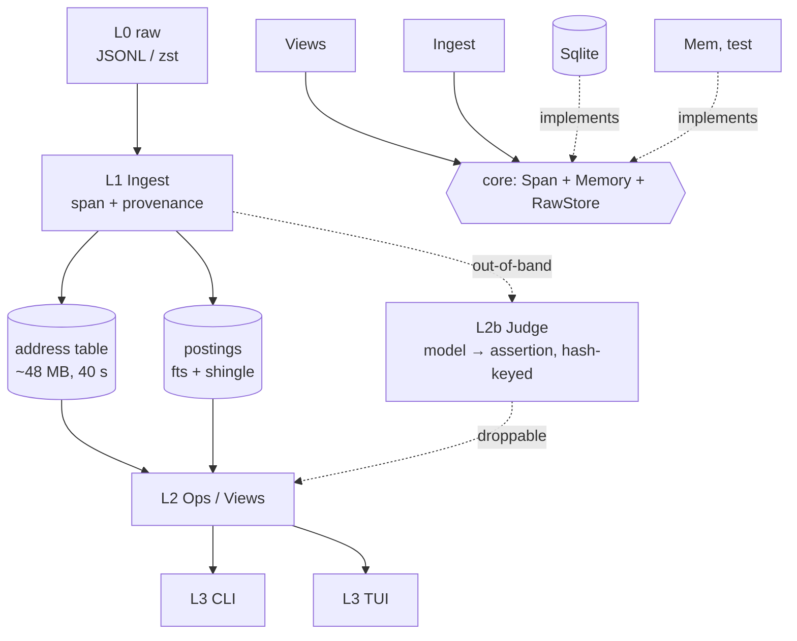
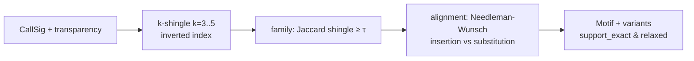

# INITIALIZATION — agents-session-explorer

Tài liệu hợp nhất toàn bộ thảo luận thiết kế. **Trạng thái: thiết kế, chưa có code.** Mọi con số đánh dấu *(đo)* được đo trên máy phát triển với corpus thật; con số đánh dấu *(suy ra)* là ngoại suy từ throughput đã đo.

## 1. Mục tiêu

Biến các file session JSONL của coding agent trong quá khứ thành **tài sản tái sử dụng**, thông qua một **operation layer (ontology) nằm trên raw data**, không phải một trình xem transcript.

Ba trục giá trị:

1. **Explore**: tìm, truy vết, tái dựng cấu trúc công việc từng diễn ra — luôn trả về được byte range trong file gốc.
2. **Derive**: suy ra các thực thể (task, attempt, episode) và quan hệ giữa chúng từ dữ liệu, không bịa thêm.
3. **Export**: xuất quan sát đã kèm bằng chứng để người dùng (hoặc LLM do người dùng điều khiển) phán đoán. Tool **không phán**.

### Non-goals

- Không phải nơi lưu nội dung đã chuẩn hoá. Raw file là sự thật duy nhất.
- Không đưa model vào query path.
- Không phán "tốt/xấu", "nên viết skill", "waste score".
- Không phụ thuộc vào index của tool khác (`~/.omp/stats.db`, `~/.codex/thread_history_*.sqlite`) — chỉ dùng để đối chiếu.

## 2. Năm bất biến thiết kế

1. **Span là đơn vị tiền tệ.** Mọi thứ (kết quả search, assertion, asset, câu trả lời của LLM) trỏ về `(file_id, byte_offset, byte_len)`. Không có ngoại lệ.
2. **Index là hàm thuần của (raw, config).** Xoá được, rebuild được, không phải nguồn sự thật.
3. **On-the-fly sống ở mức span, không ở mức corpus.** Decode 1 session ~1–10 ms; quét toàn corpus 5–40 s.
4. **Model chỉ xuất hiện trong một derivation ghi ra assertion**, keyed by content hash + version; không bao giờ trong đường tương tác.
5. **Đầu tư vào khả năng tái-suy-ra, không đầu tư vào abstraction.** Chi phí đổi ý đã đo được: rebuild toàn bộ 40 s.

## 3. Dữ liệu nguồn

Đo trên `C:\Users\admin` (Windows 10.0.26200, x64, 8 core, rustc 1.91.1).

| Store | Files | Bytes | Khoảng thời gian | Format | Index sẵn có |
|---|---|---:|---|---|---|
| `~/.omp/agent/sessions` | 3.533 | 6,171 GB | 2026-09-02 → 2026-11-09 | JSONL v3 | `stats.db` (329.277 message, 413.571 tool call, 3.530 rollup) |
| `~/.codex/sessions` | 519 `.zst` + 9 `.jsonl` | 578 MB + 2,36 MB | 2026-05-30 → 2026-10-24 | `rollout-*.jsonl.zst` | `thread_history_1.sqlite` (643 MB), `history.jsonl`, `session_index.jsonl` |
| `~/.gemini/antigravity*` | 5 JSONL (transcript stub) + 10 `.pb` | 37 MB | — | protobuf `.pb` | — |
| `~/.claude`, `~/.opencode` | 0 JSONL | — | — | — | — |

Khối lượng omp: 1.199.311 entry; 8.586 user message; 325.788 assistant; 413.686 toolResult; 27 thư mục project (25 cwd phân biệt).

Cấu trúc thư mục omp:

```
~/.omp/agent/sessions/<project>/<ts>_<uuid>.jsonl          # 118 session chính
~/.omp/agent/sessions/<project>/<ts>_<uuid>/<Agent>.jsonl  # 3.415 sidecar subagent
~/.omp/agent/sessions/<project>/<ts>_<uuid>/<n>.<tool>.log # output thô từng tool call
```

`parentSession` xuất hiện trong 3.054/3.533 file (86%). 479 file không có parent.

### 3.1 Schema omp v3 (quan sát)

```json
{"type":"session","version":3,"id":"...","timestamp":"...","cwd":"F:\\...","title":"...","parentSession":"...?"}
{"type":"title","v":1,"title":"","pad":"..."}
{"type":"model_change","id":"...","parentId":null,"model":"opencode-go/glm-5.3-flash"}
{"type":"custom","customType":"tool_execution_start","data":{"toolCallId":"call_...","toolName":"read","args":{"path":"..."},"intent":"Listing agent rules directory"},"id":"...","parentId":"...","timestamp":"..."}
{"type":"message","id":"...","parentId":"...","message":{"role":"user|assistant|toolResult","content":[{...}],"toolCallId":"...","toolName":"..."}}
```

Điểm phải xử lý đúng:

- **DAG, không tuyến tính**: entry có `parentId`; assistant message chứa block `toolCall`; kết quả là entry `message` với `role: "toolResult"`, nối bằng `toolCallId`. Không có cặp call/result kề nhau.
- `usage` nằm trên assistant message.
- Entry type quan sát được: `session`, `title`, `model_change`, `thinking_level_change`, `session_init`, `custom`, `custom_message`, `message`. Block type (`text`, `thinking`, `toolCall`, `internal`, `path`, `bash`, `report`) nằm **trong** content — không phải entry type.
- `customType` phổ biến (project `my-meta-brain`, đo): `tool_execution_start` 99.618, `session_exit` 807, `async-result` 641, `system-prompt-digest` 601, `irc:incoming` 270, `mid-run-todo-nudge` 140, `date-cwd-reminder` 116, `todo_hud_state` 76, `user_todo_edit` 38, `eval-state-context` 33, `image-attachment` 32, `skill-prompt` 23, `launch-completion` 22.

### 3.2 Schema codex

```json
{"timestamp":"...","ordinal":0,"type":"session_meta|event_msg|response_item|item_completed|token_count","payload":{...}}
```

`thread_turns` trong SQLite của codex lưu `rollout_ordinal`, `rollout_byte_offset`, `rollout_end_byte_offset` — **tiền lệ xác nhận thiết kế provenance bằng byte offset**.

## 4. Hiệu năng (đo)

| Thao tác | Thời gian / throughput |
|---|---|
| Typed deserialize + `&RawValue` (borrowed) | 562–895 MB/s |
| `serde_json::Value` | 161–423 MB/s (chậm 2,5–3,5×) |
| `memchr` scan, cache nóng | 1.910 MB/s |
| Đọc lạnh từ đĩa | 68 MB/s |
| Full parse 6,171 GB (rayon, 8 core) | 40,6 s |
| Substring scan toàn corpus (rayon) | 5,6–6,4 s (965–1.105 MB/s) |
| Decode 1 session trung vị (0,85 MB) | ~1,5 ms *(suy ra)* |
| Decode session p90 (4,1 MB) | ~7 ms *(suy ra)* |

Phân bố kích thước file omp: median 0,85 MB, mean 1,75 MB, p90 4,10 MB, max 43,9 MB.

Hệ quả: reindex toàn bộ ~2 phút lần đầu, <10 s khi cache nóng; ingest incremental là tối ưu hoá không cần thiết ở giai đoạn đầu (chỉ cần `(path, size, mtime)` để skip). Nghẽn là I/O, không phải parse → dùng rayon theo file, không dùng async.

## 5. Thành phần nội dung (đo trên project `my-meta-brain`, 1.602 MB)

| Loại text | Entry | Bytes | Tỉ lệ |
|---|---:|---:|---:|
| `toolResult` | 99.395 | 337,7 MB | 87% text |
| `assistant` | 43.722 | 47,3 MB | 12% |
| `user` | 2.048 | 2,5 MB | 0,6% |
| Tổng text | — | 390,1 MB | 24,3% byte file |
| Trùng lặp chính xác | — | 47 MB | 11,9% text |

Kết luận:

- "Tài sản" thật là prose assistant + user; ngoại suy toàn corpus ≈ 180 MB + 10 MB. Tool output là nhiễu, chỉ index metadata (tool, args signature, path, exit code, độ dài).
- 11,9% trùng lặp chủ yếu do assignment prompt lặp cho 28 subagent cùng task ⇒ phải dedupe theo `text_hash` trước khi đếm bất cứ thống kê nào, và đếm theo **task**, không theo session.

## 6. Mô hình dữ liệu

### 6.1 Span

```rust
struct SpanRef { file: FileId, off: u32, len: u32 }
```

Bất biến: offset trỏ vào raw file, không trỏ vào bản copy. omp append-only nên offset cũ luôn hợp lệ. Codex `.zst`: index theo `(file, ordinal)` + offset trong luồng đã giải nén, không giả định offset byte nén ổn định.

### 6.2 Event / Turn / Episode

```
Session  (id, provider, source_version, path, parent_session_id, agent_name, cwd, title, started_at)
Event    (session, ordinal, byte_offset, byte_len, ts, actor, kind)
  kind ∈ SessionMeta | UserInput | AssistantText | Reasoning | ToolCall
       | ToolResult | Notice(custom_type) | Title | ModelChange | Usage | Unknown
Turn     (session, index, request_ts, model, input_tokens, output_tokens, cost, duration_ms, stop_reason)
Episode  (session, turn_range, user_intent_text)
```

Invariants:

- Entry type lạ → `Unknown` giữ nguyên `RawValue`, **không drop**. Schema drift không được làm mất dữ liệu.
- Turn = một chu kỳ request/response (assistant message + toolCall của nó + toolResult tương ứng), giới hạn bởi user input. Episode = chuỗi turn trong cùng một yêu cầu người dùng.
- Branch (retry/edit/resume) phải giữ được; đường "active" = đuổi theo leaf mới nhất.

### 6.3 Task / Attempt / Role

Thực thể thật là `Project → Task → Role stream → Attempt → Session → Turn`, không phải `Task → nhiều session` phẳng.

Bằng chứng đo được:

| Task | File | Main | Sub | Parent session | Khoảng thời gian | Nhánh vai trò |
|---|---:|---:|---:|---:|---|---:|
| `S18-T70` | 29 | 1 | 28 | 2 | 17 ngày (09-23 → 10-10) | 7 |
| `S18-T71` | 10 | 2 | 8 | 2 | **47 ngày** (09-23 → 11-09) | 5 |
| `S8.13` | 23 | 1 | 22 | 1 | 4 ngày | 7 |
| `S14-T3` | 13 | 1 | 12 | 1 | <1 ngày | 6 |

Tên subagent của `S18-T70` (đo, đầy đủ 28):

```
A01..A03  BS01..BS03  BSR01..BSR03  C01..C06  CP01..CP04  CR01..CR06  DEP01..DEP03
```

Tức `Task` + `Role` + `Attempt` được mã hoá trong **tên file**, không có trong JSON. Đây là nguồn khoá task chính (86% file), không phải `task_id=` trong text.

Số liệu task:

| Chỉ số | Giá trị |
|---|---:|
| File có `task_id=` | 593 / 3.533 (16,8%) |
| Task id phân biệt | 380 |
| Task id trải ≥2 file | 207 / 380 |
| File chứa ≥2 task id | 82 (2,3%) |
| Task trải rộng nhất | `S18-T70` → 29 file |

Đồng thời: delegation chủ yếu **nối tiếp**, không song song — 58 parent có ≥3 subagent, overlap thời gian trung bình 0,16, chỉ 7/58 > 30%. Vì vậy tài sản giá trị nhất là **delta giữa attempt n và n+1**, không phải "fan-out".

## 7. Kiến trúc

### 7.1 Sơ đồ



Gọi `Memory`/`RawStore` là **seam/substrate**, không phải "tầng 4": mọi tầng phụ thuộc nó, nó không phụ thuộc tầng nào.

### 7.2 Bốn tầng sống + hai hộp phụ

| Hộp | Nội dung | Kích thước | Latency | Rebuild | Sự thật? |
|---|---|---|---:|---|---|
| L0 raw | file gốc, bất biến | 6,75 GB | seek | không bao giờ | **có** |
| L1 address | `(file, ordinal, offset, len, ts, kind, role, text_hash)` + task key + CallSig + shingle | ~48 MB + ~25 MB | <1 ms | 40 s | không |
| L1b postings | FTS5 trên prose + inverted shingle index | 350–500 MB + 20–30 MB | <50 ms | ~60 s | không |
| L2 ops | views (search/stats/motif/timeline/task/diff) | — | — | — | không |
| L2b judge | assertions từ model | vài MB | <1 ms đọc | phút–giờ | không, **droppable** |
| L3 app | CLI / TUI | — | — | — | không |

### 7.3 Crate layout và luật phụ thuộc

```
ase-core      types only (Span, CallSig, Event, Assertion, View, Memory, RawStore)
ase-ingest    source impls (omp, codex) + span emit        — fs, zstd
ase-index     schema + postings                            — sqlite, fts5
ase-ops       views                                        — core + index
ase-judge     model calls → assertions  (feature = "judge")— network/model
ase-cli       render
ase-tui       render
```

Luật enforce bằng CI, không bằng kỷ luật:

- `ase-core` không được kéo `sqlite`, `fs`, `network`.
- `ase-ops` không được import `ase-judge`.
- `ase-cli`/`ase-tui` chỉ compose `ViewResult` và render; không parse raw, không tự tính, không gọi model.

### 7.4 Memory seam

Hai seam riêng, không gộp:

| | `Memory` (store) | `HotCache` (RAM) |
|---|---|---|
| Chứa | address, postings, assertions, project profile, build metadata | span/episode đã decode |
| Sống | vĩnh viễn, xoá được | trong process, LRU theo **byte** |
| Impl | `Sqlite`, `Mem` (test) | `Lru` |

```rust
pub trait Memory {
    fn task(&self, key: &TaskKey) -> Option<TaskNode>;
    fn postings(&self, term: &Term) -> Box<dyn Iterator<Item = Posting> + '_>;
    fn assertions(&self, subject: Entity, pred: Predicate) -> Vec<Assertion>;
    fn ranges(&self, q: &RangeQuery) -> Vec<SpanRef>;
    fn meta(&self) -> BuildMeta;   // build_id, schema_version, watermark
}

pub trait RawStore {
    fn read(&self, span: SpanRef) -> Result<Cow<'_, [u8]>>;  // mmap | giải nén vào buffer
}
```

Ba bất biến của seam:

1. **Content-free**: chỉ địa chỉ + thống kê + phán quyết. Không decode text/JSON vào store.
2. **Freshness watermark**: mỗi file có `(size, mtime)`; kết quả query mang `freshness` để báo "index chậm N turn", không im lặng trả dữ liệu cũ.
3. **Stale ≠ error**: `assertion.derived_by = (build_id, view_version, judge_id)`; lệch build → đánh dấu stale, vẫn phục vụ.

Ngân sách hot cache: 256 MB giữ ~300 session median hoặc ~60 session p90. LRU theo byte vì chênh lệch median/p90 là 5×.

Không được rơi vào seam: decoder, model/embedding, async/remote backend. Một trait, hai impl (`Sqlite`, `Mem`) là đủ.

## 8. Task resolver

Thứ tự cố định, dừng ở tầng đầu tiên khớp:

| # | Nguồn | Phủ | Chi phí | Kết quả |
|---|---|---|---:|---|
| 1 | Grammar tên file (`<task><role><attempt>`) | 86% file | regex + cluster | `TaskKey`, `role`, `attempt` |
| 2 | `parentSession` | 86% file | có sẵn | cây delegation (không cho task) |
| 3 | `task_id=` trong text | 17% file / 380 id | regex | xác nhận chéo, alias |
| 4 | Structural continuation: cùng cwd + Jaccard path-set + time gap | phần còn lại | vài ms/session | `continues` edge + confidence |
| 5 | Semantic boundary (SLM) | 3.247 user msg thuộc 768 session không có task key | model, cache | `split`/`continue` |

Số liệu nền cho tầng 5: 2.343 session chỉ có 1 user message (không cần phân đoạn); 1.181 session có ≥2 user message (6.243 msg); 768 trong số đó không có `task_id` (3.247 msg). Đây là trần chi phí model — không phải 1,2M entry.

### 8.1 Grammar tên file: suy ra từ corpus, không hard-code

Trong phạm vi `(project, parent)`, cluster basename theo prefix chung dài nhất. Hai tên cùng cluster khác hậu tố ⇒ hậu tố = `role` (chữ) + `attempt` (số). Split phải đệ quy trên nhiều điểm cắt: cắt số cuối đơn thuần sai (`S18T30A` / `S18T30SR` / `S18T30DEP`). Đo được 1.098/3.054 tên (36%) nằm trong cluster nếu chỉ cắt số cuối ⇒ cận dưới, không phải coverage thật.

Hai dạng phải chấp nhận:

```
S18Task70BS01        → project S18, task 70, role BS, attempt 01
S813BoundaryGold23   → project S8, task 13, role BoundaryGold, attempt 23
S14T3ProviderA5      → project S14, task 3, role ProviderA, attempt 5
```

Kết quả parse là **assertion có evidence (danh sách tên file)**, version hoá; fallback khi thất bại: `Task = parent session + time bucket`. Cần op `ase audit naming --project X` báo coverage + danh sách tên không parse được.

### 8.2 Attempt ordering

Số trong tên chỉ là **nhãn**, không phải thứ tự: `S18-T71` có nhánh mới 47 ngày sau. Thứ tự hiển thị mặc định theo timestamp; "attempt mới nhất" phải tính theo thời gian, nếu không search sẽ trỏ về attempt cũ trong khi task đã tiến hoá.

## 9. Operations (views)

Mỗi view trả `ViewResult { rows, evidence: Vec<SpanRef>, freshness, build_id, explain: Vec<Step> }`.

| Op | Cơ chế | Latency | Tất định | Model |
|---|---|---|---:|---|
| `search` (FTS) | tra postings | <50 ms | có | không |
| `regex` | quét span đã index | 50 ms – 6 s | có | không |
| `stats.address` | aggregate trên address | <10 ms | có | không |
| `stats.content` | pass trên prose, cache | 40–60 s | có | không |
| `motif` | shingle + alignment | phút | có | không |
| `semantic` | embedding/cluster | phút–giờ | **không** | **có** |

Surface tối thiểu:

```
ase index [--layer address|postings|all]
ase show <span|task:ID|session:ID> [--turn a:b] [--role assistant]
ase search "<query>" [--collapse latest-attempt] [--all-attempts] [--explain]
ase resolve task:S18-T70 --explain
ase lineage --project anomaly --tree
ase timeline task:S18-T71 --bursts [--by model|project]
ase diff S18Task70A02 S18Task70A03 --by commands,paths
ase motif list|show|stats [--project X]
ase export motif:<id> --out dir/
ase import verdicts <file>
ase verify <bundle|view>
ase audit naming --project X
ase gc --layer L2b --stale 30d
```

`--explain` là điều kiện để gọi đây là operation layer: luôn trả lời được *vì sao* hai thứ được nối, kèm con trỏ byte.

## 10. Motif / boilerplate

Mục tiêu: tìm **chuỗi hành vi lặp lại** (tool call + dạng tham số), không phải đoạn text lặp (cái đó dedupe bằng hash).

### 10.1 Chuẩn hoá (80% công sức)

```rust
struct CallSig { tool: ToolId, arg_shape: ArgShape, intent_cluster: Option<ClusterId> }
// ArgShape: path → <project>/<class>/<phase>, cmd → argv0 + flags, url → host
```

- Bỏ project root, thay path bằng `class:<ext>` + `phase` (đọc lần đầu / đọc lại / ghi).
- Nếu không chuẩn hoá, cardinality nổ và mọi n-gram có support = 1.
- **Transparent calls**: tool chỉ đọc lại thứ đã đọc / `git status` / `ls` lặp lại được đánh dấu trong suốt khi so khớp chuỗi, vẫn đếm trong thống kê. Đây là ca "chèn vài tool ở giữa" phổ biến nhất.

### 10.2 Ba tầng matching



- ~400k tool call (đo qua 413.686 toolResult) → ~1,2M shingle `k=3` → index 20–30 MB.
- `insertion` (tool chèn thêm, giữ thứ tự) và `substitution` (đổi cách làm) là hai kết luận khác nhau, không được gộp trong một score.

### 10.3 Thống kê hợp lệ

- Luôn báo **cả** `support_exact` và `support_relaxed(g)`. Cho phép gap thì support tăng đơn điệu; motif 2 phần tử với gap lớn khớp gần như mọi thứ.
- Null model bắt buộc: so với kỳ vọng khi xáo trộn call, hoặc lift trên tần suất biên từng tool. Báo `z`/`lift`, không báo "xuất hiện 34 lần".
- Đếm theo **task** (đã chốt), không theo session/attempt: `S18-T70` là **1** quan sát, không phải 29.
- Dedupe theo `text_hash` trước khi đếm (11,9% trùng).

### 10.4 Ritual vs procedure

| Dạng | Đặc điểm | Kết luận |
|---|---|---|
| Ritual | thứ tự cố định, tham số gần như bất biến | ứng viên tự động hoá / bỏ |
| Procedure | cùng intent, tham số biến thiên | ứng viên viết skill/template |

Hai dạng có cùng support cao nhưng kết luận ngược nhau. Tool chỉ **phân loại bằng đặc trưng đo được** (variance của arg-shape, độ biến thiên thứ tự), không kết luận "nên bỏ" hay "nên viết skill".

## 11. Export contract (explore-only)

Tool xuất **quan sát + câu hỏi**; người/LLM phán. Không score, không verdict.

| Trường | Bản chất | Ai điền |
|---|---|---|
| `signature`, `support_exact/relaxed`, `lift`, `spans`, `variants`, `timing`, `failure_rate` | quan sát, kiểm chứng lại được | tool |
| `hypothesis`, `should_codify`, `waste_score` | phán đoán | **để trống**; LLM/user qua `ase import` |

```
motifs/<id>/
  motif.json      # signature, support, lift, variants, spans[], index_build_id, query
  evidence.md     # 3–5 lần xuất hiện đại diện, header file:offset
  questions.md    # câu hỏi cụ thể, trả lời được bằng evidence
```

Quy tắc:

- `id = blake3(canonical_signature)` ⇒ chạy lại ra cùng id; kết luận LLM tích luỹ thay vì mất; diff giữa hai lần build là diff thật.
- Chọn đại diện **tất định**: sớm nhất, muộn nhất, lệch nhiều nhất, một lần có failure. Trần ~8k token/bundle.
- **Redaction trước khi export**: chỉ `tool + args signature + N dòng đầu output`. Không xuất output thô (87% byte, có thể chứa đường dẫn/secret nội bộ) — bundle sẽ được paste vào LLM cloud.
- `ase verify <bundle>` đọc lại raw tại từng span và so khớp excerpt. Không có bước này, export chỉ là văn bản trang trí.
- `ase import verdicts <file> --bundle DIR --local-map FILE --store FILE` ghi phán đoán ngoài vào một lớp assertion riêng (`ase-assertions-v1`), chỉ sau khi mở lại bundle và mọi evidence ref; `assertion_id` là khóa nội dung, nhập lại cùng nội dung không nhân đôi, ref từ bundle khác bị từ chối. Xem `artifacts/sprint-7/ASE-S7-T4/README.md` và contract-a1 §4. Không gọi model, không đo gate ở bước này.
- `ase join skill-gap --store FILE --catalog FILE --bundle DIR --local-map FILE` đối chiếu assertion đã xác minh với catalog do người dùng đưa ra, so khớp chính xác `(kind, key/alias)`, phân biệt `match`/`no_match`/`ambiguous`/`insufficient_input` và tôn trọng `completeness[kind]`. Không khớp catalog không phải bằng chứng skill không tồn tại hoặc nên tạo; truy vết giữ `evidence_refs`/span không lộ đường dẫn nguồn. Xem `artifacts/sprint-7/ASE-S7-T5/README.md` và contract-a1 §5. Không ghi store, không gọi model, không đo gate.

## 12. Ranh giới LLM

```
L1 → view motif → export bundle → [LLM ngoài] → import verdict (L2b) → query lại
```

- Model chỉ ghi assertion, key = `blake3(span_text) + view_version + judge_id` (mẫu tham chiếu: `frustration_verdicts(prose_hash, judge)` của omp).
- Cache invalidation theo **span**, không theo file: omp append vào cuối file, hash toàn file sẽ invalidate mỗi turn.
- Assertion thiếu `evidence` bị reject tại lúc insert, không phải lúc read.
- Ngân sách đã biết: 3.247 user message cho boundary detection; ~1M token cho SLM local.

## 13. Lộ trình

| Phase | Nội dung | Nghiệm thu |
|---|---|---|
| P0a | `Source` + `Decoder` omp/codex, L1 address-only, `show`/`resolve --explain` | index 6,17 GB ≤ 60 s; `show` p99 < 20 ms; 100% span verify lại |
| P0b | postings (FTS prose + shingle index) | `search` p99 < 50 ms; index ≤ 500 MB |
| P0c | task resolver tầng 1–3 (không model) + `audit naming` | tái tạo đúng 207 task liên-file; đo precision trên 380 id |
| P0d | motif: shingle → family → alignment + null model | fixture test gapped support; ablation `τ`/`g` trên 380 task id |
| P1 | Turn/Episode + branch leaf-chase + delta giữa attempt | đếm turn khớp `stats.db` (329.277) lệch < 1% |
| P2 | time analytics (model × project × cost/latency, sum vs wall-clock) | đối chiếu cost 1 tháng với `stats.db` |
| P3 | Judge + SLM cho 3.247 msg còn lại, cache L2b | chạy lại 0 call model; ablation trên 372 recap |
| P4 | export/import + `verify` + skill-gap join | ≥ 80% assertion trích được evidence; `verify` pass 100% |

Phase P1+ chỉ là projection của bảng `events` + address; không có schema mới.

## 14. Rủi ro

| Rủi ro | Dấu hiệu | Chặn |
|---|---|---|
| God module ở tầng ops | model/embedding bị import từ ops | CI dependency rule (§7.3) |
| Store phình thành bản sao raw | DB tăng > 1 GB | bất biến content-free (§7.4) |
| Support phồng do gap | motif nào cũng support cao | null model + báo cả exact/relaxed (§10.3) |
| Nhiễu do fan-out subagent | cùng motif đếm 29 lần | đếm theo task (§10.3) |
| Offset trôi | `.zst` tái nén, file bị sửa | index theo `(file, ordinal)`, `verify` trước khi export |
| Index lỗi thời mà im lặng | kết quả thiếu turn mới | freshness watermark (§7.4) |
| PII/secret rò qua export | bundle chứa output thô | redaction + `verify` (§11) |
| Abstraction sớm | trait cho thứ chưa có impl thứ hai | một trait, hai impl; hoãn đến khi có provider thứ 2 thật |

## 15. Câu hỏi mở

1. `τ` (Jaccard) và `g` (gap) mặc định: chọn bằng ablation trên 380 task id, chưa chốt.
2. Thứ tự attempt: đã quyết theo timestamp; còn mở là cách hiển thị khi hai nhánh role chồng lấn thời gian.
3. Có cần index `thinking` không: 43.722 assistant entry chứa thinking block; chi phí ~vài chục MB, chưa quyết.
4. `irc:incoming` (270 lần) — cross-agent message graph có nên thành view riêng không.
5. Ranh giới "explore" với `diff` attempt: `diff` là thống kê cấu trúc (được), nhưng "attempt nào tốt hơn" thì không (thuộc Judge).

## 16. Nhật ký kiểm chứng

Hai nhận định ban đầu bị số liệu bác bỏ, giữ lại để tránh lặp lại:

1. `"type":"report"` **không phải** entry type: 0/3.533 file. Hai lần xuất hiện ban đầu là block type trong content. Histogram entry-type và block-type phải đếm riêng.
2. Entry `title` rỗng ở 98,6% file (0/3.054 subagent). Nhãn phải lấy từ `task_id`, `user_todo_edit`/`todo_hud_state` (79 session), `session_titles` (103) và `session_recaps` (372 recap đã có trong `~/.omp/agent/history.db`).

Thêm: corpus chứa sẵn 372 recap do LLM sinh — dùng làm pseudo-ground-truth cho phân đoạn task, không cần gán nhãn tay.

## 17. Cách tái lập số đo

```bash
# kích thước và phân bố
find ~/.omp/agent/sessions -name '*.jsonl' -printf '%s\n' \
  | awk '{a[NR]=$1; s+=$1} END {printf "n=%d total=%.0fMB median=%.2fMB p90=%.2fMB\n", NR, s/1e6, a[int(NR*0.5)]/1e6, a[int(NR*0.9)]/1e6}'

# throughput parse: benchmark crate tạm (serde_json, borrowed &RawValue, rayon)
# - typed borrowed: 562-895 MB/s; Value: 161-423 MB/s; full corpus: 40,6 s
# substring scan toàn corpus: memchr + rayon, 5,6-6,4 s

# đối chiếu index sẵn có của omp
sqlite3 ~/.omp/stats.db "select count(*) from messages; select count(*) from tool_calls;"
sqlite3 ~/.omp/history.db "select count(*) from session_recaps;"   # 372
```

Môi trường đo: Windows 10.0.26200, 8 core, rustc 1.91.1, volume `F:` (77% đầy).
